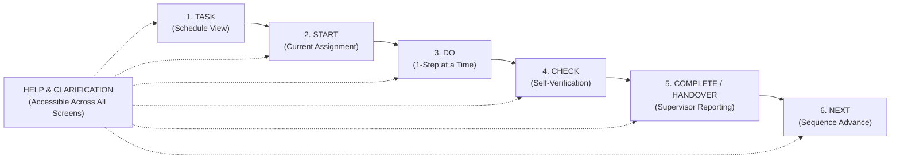

# FORMAL QUOTATION & TECHNICAL PROPOSAL

**Ref. No.:** DSS2026/RFQ/0210  
**Date of RFQ:** 09 October 2026  
**Quotation Date:** 14 October 2026  
**Valid Until:** 30 November 2026  

---

### **CLIENT DETAILS**
* **Institution:** APSN Delta Senior School (DSS)
* **Department:** Vocational Training, Retail and Warehousing Services Department
* **Attn:** Ms. Eileen Soo, HOD / Principal Trainer
* **Subject:** Quotation for Design, Development, Testing, Deployment, Training, and Support for a Browser-Based Workplace Task-Support Application

---

## 1. Executive Summary & Solution Overview

In response to Invitation to Quote **Ref. No.: DSS2026/RFQ/0210**, we are pleased to submit our comprehensive proposal and itemised quotation for the **Browser-Based Workplace Task Support Application** for APSN Delta Senior School (DSS).

The proposed solution is an **offline-first, browser-based Progressive Web Application (PWA)** specifically architected for authentic workplace environments (including retail, warehousing, logistics, and office services) and regular tablet devices (such as school-managed Apple iPads). The application provides structured, predictable visual and prompt-supported workflows to help students start, perform, check, complete, and hand over authentic workplace tasks with increased independence and fewer unnecessary adult prompts.

### Core Pedagogical & Intervention Principle
As stipulated in the technical specifications:
> **"The application is the intervention. Successful use of the application shall not be treated as automatic evidence that the physical workplace task has been completed correctly."**

The application deliberately incorporates explicit verification, physical checking requirements, and completion-reporting instructions. Digital advancement does not automatically certify physical task correctness; rather, it guides the student through self-checking, workplace communication, and physical handover to the workstation supervisor or trainer for authentic evaluation.

---

## 2. Core Functional Architecture

### 2.1 Prescribed Student Workflow: Task → Start → Do → Check → Complete / Handover → Next

1. **TASK (Schedule Identification):**
   - The student views today’s scheduled workplace assignments (`NOW`, `NEXT`, `LATER`).
   - Clean, uncluttered layout with zero unnecessary cognitive choices.
   - One-tap navigation to the active task.

2. **START (Task Launch):**
   - Clear identification of the workplace task title and context.
   - Large, high-contrast primary call-to-action (`START TASK`).
   - Unambiguous visual affordance suitable for touch screen operation.

3. **DO (Step-by-Step Task Guidance):**
   - Displays guidance **one step at a time** to prevent visual overload.
   - High-resolution photograph or visual media alongside short, workplace-appropriate text.
   - Predictable navigation with large touch targets:
     - `NEXT STEP` advances sequentially (or transitions to `CHECK` on the final step).
     - `PREVIOUS STEP` enables returning to earlier steps when needed.
   - Visual step progress badge (`Step X of Y`).

4. **CHECK (Physical Verification Actions):**
   - Displays task-specific verification requirements configured by DSS trainers.
   - Interactive checkbox cards with generous touch targets (>= 60px).
   - Progression is gated: the student can only proceed to completion after verifying each physical requirement.

5. **COMPLETE / HANDOVER (Reporting & Verification):**
   - Displays configured workplace completion communication phrase (e.g. *"I have finished this task. Please check."*).
   - Displays specific physical handover instructions (e.g. *"Place sealed cartons on Inspection Table B and notify supervisor."*).
   - Prominently reinforces the pedagogical notice: physical inspection by a trainer or employer is required.
   - Student confirms completion and hands over work.

6. **NEXT (Sequence Progression):**
   - Unambiguously indicates the prior task is finished.
   - Automatically loads the next scheduled assignment in sequence or presents the congratulatory completion state when all daily tasks are accomplished.

---

### 2.2 Help and Clarification Support (Accessible Throughout)
- Accessible across all screens via a persistent high-contrast header button: **`I NEED HELP / CLARIFICATION`**.
- Opens a dedicated modal without exiting, interrupting, or resetting the active task workflow or losing checklist progress.
- Features dual support:
  1. **Configured Task-Specific Help Guidance:** Trainer-specified instructions for handling common bottlenecks.
  2. **Workplace Communication Phrases:** Standard workplace self-advocacy phrases formatted with large touch-selectable cards:
     - 🗣️ *"Excuse me, I need help with this step."*
     - ❓ *"Could you please clarify what I should do next?"*
     - 📦 *"I am missing some materials or supplies."*
     - ✅ *"Could you please check if my work is correct?"*
  3. **Visual Self-Advocacy Mode:** Tapping any phrase displays it in an enlarged, high-contrast visual banner, enabling students with diverse communication needs to show their screen directly to a supervisor or employer.

---

### 2.3 Trainer / Employer Task & Content Management
Authorized DSS staff access the administration dashboard using a configurable security PIN (default: `1234`). Key capabilities include:

* **Task Template Management:**
  - Create new reusable task templates.
  - Edit task titles, workplace descriptions, help phrases, completion phrases, and handover instructions.
  - **Duplicate / Clone:** One-tap cloning of templates to adapt routines for different employers or student profiles.
  - **Archive and Restore:** Archive retired or seasonal templates without permanent deletion; restore archived templates at any time.
  - **Delete Protection:** Safeguards preventing accidental deletion of tasks currently in-progress or assigned to today's schedule.
* **Step Configuration & Multi-Media:**
  - Add, edit, remove, and reorder steps using up/down controls.
  - Short written instructions per step.
  - **Direct Camera & Photo Upload:** Integrated camera capture on Apple iPad and desktop file upload, with local Base64 storage and sample placeholder generation.
* **Checking & Handover Requirements:**
  - Configure customized self-checking checklist items.
  - Reorder and edit verification items.
  - Define custom workplace handover instructions.
* **Daily Scheduling & Sequence Management:**
  - Add task templates to daily routines (`NOW`, `NEXT`, `LATER`).
  - Arrange and reorder task sequence.
  - Date navigation and schedule planning.
* **Learner Preview Mode:**
  - Realistic full-screen student view simulation within staff mode to test student experience before deployment, with isolated state and zero side effects on real student progress.
* **Reset and Resume Controls:**
  - Reset unfinished tasks back to initial state.
  - Resume in-progress tasks directly at the student's last step.
* **Workstation & Generalization Settings:**
  - **Zero hardcoding:** Configurable organization name (*APSN Delta Senior School*), workstation identifier (*Workstation 1*), and department/setting (*Retail & Warehousing Services*).
  - Configurable 4-digit staff security PIN.
  - Backup & Restore via one-click JSON export/import.
  - Offline-first persistence in browser `localStorage`.

---

## 3. Technical & Platform Specifications

| Requirement | Proposed Solution Specification | Compliance |
| :--- | :--- | :---: |
| **Application Type** | Browser-Based Progressive Web Application (PWA) | **Full** |
| **Target Devices** | Apple iPad (iPadOS 15+, Safari/Chrome), Windows 10/11, macOS, Android tablets, Chromebooks | **Full** |
| **Supported Browsers** | Safari 15+, Google Chrome 90+, Microsoft Edge 90+, Firefox 90+ | **Full** |
| **Offline Operation** | 100% Offline-capable via Service Worker (`sw.js`), Cache API, and Web App Manifest (`manifest.json`). Zero internet required after initial load. | **Full** |
| **Hosting & Cloud Dependencies** | **None.** Zero mandatory external cloud servers, databases, or third-party subscriptions. Runs entirely client-side or on school intranet. | **Full** |
| **Data Storage & Persistence** | Local browser storage (`localStorage` & Cache API). Fully persistent across browser restarts, page reloads, and device sleep. | **Full** |
| **Data Privacy & PDPA** | All student progress, photos, and configurations remain 100% local on the school device. No student data transmitted externally. | **Full** |
| **Backup & Restoration** | One-click JSON backup export and restoration with format schema validation. | **Full** |
| **Deployment Method** | Standalone static file bundle (HTML, CSS, JS, Manifest, SW) deployable on school intranet, web server, or locally via iPad file distribution. | **Full** |
| **Recurring Costs** | **$0.00 / year.** No mandatory vendor subscriptions, recurring license fees, or platform lock-in. | **Full** |

---

## 4. Itemised Price Quotation (SGD)

In accordance with the quotation guidelines of **Ref. No.: DSS2026/RFQ/0210**, all items are clearly itemised:

| Item No. | Deliverable / Service Description | Cost (SGD) |
| :---: | :--- | :---: |
| **1.0** | **Requirements Clarification & Solution Design** • Technical stakeholder consultation with DSS project team • Pedagogical workflow alignment & cognitive load analysis | \$1,200.00 |
| **2.0** | **UI / UX Design for Diverse Learning Needs** • High-contrast, large touch-target design system (>= 60px) • Distraction-free workstation screen layouts and iconography | \$1,500.00 |
| **3.0** | **Browser-Based Core Application Development** • Offline-first PWA architecture (Service Worker, Cache API) • Apple iPad & desktop browser compatibility implementation | \$2,800.00 |
| **4.0** | **Student-Facing Workflow Engine** • Complete implementation of `Task → Start → Do → Check → Complete / Handover → Next` • Real-time help modal with customizable communication & clarification phrases • Visual self-advocacy phrase display for non-verbal students | \$2,400.00 |
| **5.0** | **Employer / Trainer Task-Management Functions** • Reusable task template CRUD with duplication & archive/restore • Multi-step editor with direct iPad camera capture & photo upload • Dynamic checklist creator & handover requirements configurator • Daily scheduling, sequence reordering, reset & resume controls • Workstation generalization settings (zero hardcoded employer names) | \$2,600.00 |
| **6.0** | **Testing and User Acceptance Testing (UAT) Support** • Comprehensive functional testing on Apple iPad and school browsers • UAT execution with DSS staff and defect rectification | \$1,200.00 |
| **7.0** | **Deployment & Distribution Setup** • Production deployment package setup on school-managed infrastructure • Local iPad PWA installation setup and offline validation | \$800.00 |
| **8.0** | **Training and Documentation** • Comprehensive Administrator & Trainer User Manual (PDF & Markdown) • Deployment, backup/restore, and troubleshooting operational guide • Hands-on training session for DSS trainers and staff | \$900.00 |
| **9.0** | **Source Code & Complete Project Handover** • 100% transfer of custom source code, build scripts, and documentation • Zero proprietary lock-in; DSS/APSN retains full maintenance freedom | **INCLUDED** (\$0.00) |
| **10.0** | **12-Month Comprehensive Warranty & Defect Support** • Rectification of functional defects and device compatibility patches • Next-business-day email and phone technical support | **INCLUDED** (\$0.00) |
| **11.0** | **Third-Party Licenses / External Hosting / Recurring Charges** • Client-side architecture requires zero external hosting or recurring licenses | **\$0.00 / year** |
| | **Subtotal (SGD):** | **\$13,400.00** |
| | **GST (9%):** | **\$1,206.00** |
| | **TOTAL ALL-IN QUOTATION (SGD):** | **\$14,606.00** |

---

### Optional Services (Priced Separately – Outside Mandatory Scope)

| Option No. | Optional Item Description | Pricing (SGD) |
| :---: | :--- | :---: |
| **OPT-1** | **Post-Warranty Annual Maintenance SLA (Year 2 onwards)** • Includes ongoing browser/OS compatibility updates and tier-2 support. • *Note: Application remains 100% operational if SLA is not renewed.* | \$1,500.00 / year (optional) |
| **OPT-2** | **Multi-Workstation Central Synchronisation (Optional Cloud Tier)** • Central cloud console to sync templates across multiple DSS classrooms. • *Note: Not required for core workstation operation.* | \$2,200.00 (optional) |

---

## 5. Project Delivery Schedule & Milestones

The proposed delivery timeline spans **8 weeks** from contract award to final handover:

| Stage / Milestone | Duration | Key Deliverables & Activities |
| :--- | :---: | :--- |
| **Milestone 1: Project Initiation & Requirements** | Weeks 1 – 2 | Requirements clarification briefing with DSS project team; finalized screen designs, wireframes, and pedagogical interaction review. |
| **Milestone 2: MVP Development & Content Engine** | Weeks 3 – 5 | Core browser application development, PWA offline configuration, student workflow engine, trainer task management, and camera/photo integration. |
| **Milestone 3: Internal Testing & UAT Release** | Week 6 | Deployment of UAT build on school iPads; end-to-end verification of task creation, photo upload, checking, handover, and sequence advance. |
| **Milestone 4: Defect Rectification & Final Packaging** | Week 7 | Rectification of any agreed UAT observations; final production optimization and offline cache verification. |
| **Milestone 5: Staff Training & Final Handover** | Week 8 | On-site hands-on staff training session (up to 15 DSS staff); handover of complete source code, operational documentation, and warranty commencement. |

---

## 6. Staff Training & Handover Plan

* **Mode of Training:** In-person, hands-on workshop at APSN Delta Senior School campus (with remote videoconference option).
* **Duration:** 1 half-day session (3.5 hours) plus 1 follow-up Q&A clinic (1.5 hours).
* **Target Audience:** Up to 15 DSS staff members (Vocational Trainers, HODs, Job Coaches, and Allied Health Professionals).
* **Training Curriculum:**
  1. Overview of the workplace intervention model and student workflow.
  2. Creating, editing, and duplicating task templates.
  3. Capturing and uploading step photos using iPads.
  4. Configuring task-specific checklists, handover instructions, and communication phrases.
  5. Managing daily schedules (`NOW`, `NEXT`, `LATER`) and sequence ordering.
  6. Using Learner Preview mode and resolving student workflow resets/resumes.
  7. Performing backups, JSON restoration, and offline troubleshooting.
* **Documentation Provided:**
  - *DSS Workplace Task Support Administrator & Trainer Guide* (Illustrated PDF).
  - *Quick Reference Workstation Card* for student orientation.
  - *Technical Deployment and Maintenance Reference*.

---

## 7. Intellectual Property, Source Code & Warranty Terms

1. **Ownership & IP:** Upon completion and payment, 100% ownership of custom source code, graphic assets, configuration files, and documentation shall be irrevocably transferred to APSN Delta Senior School / APSN.
2. **Third-Party & Open-Source Components:** Built using standard, permissible open-source web technologies (HTML5, CSS3, modern JavaScript, Tailwind CSS). No restrictive or proprietary vendor frameworks.
3. **No Vendor Lock-In:** Complete source code and project files will be handed over. DSS or any appointed third-party developer may maintain, update, or expand the application without dependency on the original vendor.
4. **Warranty Period:** **12 months** from date of formal acceptance and handover.
   - **Scope:** Rectification of reproducible software bugs, UI rendering errors, storage anomalies, and critical browser compatibility patches.
   - **Response Time:** Initial response within **4 business hours**; patch turnaround within **2 business days** for high-severity issues.
5. **Confidentiality & PDPA:** The vendor shall treat all DSS student, staff, and workplace materials as strictly confidential. No photography, video, or data shall be stored externally or reused for marketing purposes without prior written authorization from APSN.

---

## 8. Detailed Compliance Matrix (Ref. No.: DSS2026/RFQ/0210)

| Clause / Requirement | Status | Response / Evidence in Solution |
| :--- | :---: | :--- |
| **Core Workflow:** Task → Start → Do → Check → Complete / Handover → Next | **COMPLIED** | Fully implemented in navigation rail and student screens with strict sequence gating. |
| **Accessible Help / Clarification:** Accessible throughout workflow without leaving task | **COMPLIED** | Persistent top-bar button opens non-disruptive modal with task guidance and communication phrases. |
| **Photographs / Visual Media:** Add photos to steps | **COMPLIED** | Direct iPad camera capture, desktop file upload, base64 local storage, and sample photo generator. |
| **Task Checking Actions:** Checking before completion | **COMPLIED** | Gated checking screen requires physical verification of all configured checklist items before handover. |
| **Completion / Handover Guidance:** Configured phrases & instructions | **COMPLIED** | Dedicated handover screen displays configured workplace phrases and trainer inspection instructions. |
| **Pedagogical Intervention Rule:** App completion is not physical correctness proof | **COMPLIED** | Explicitly incorporated into pedagogical notice banners on handover and completion screens. |
| **Reusable Templates:** Create, edit, duplicate, archive, remove | **COMPLIED** | Full template management suite including one-click clone, archive/unarchive, and protected deletion. |
| **Sequencing & Schedule:** Daily routines and order | **COMPLIED** | Schedule manager supports daily task allocation (`NOW`, `NEXT`, `LATER`) with sequence reordering. |
| **Student Preview Mode:** Preview from student view | **COMPLIED** | Workstation preview feature allows trainers to preview student view with zero progress side effects. |
| **Reset / Resume:** Recovery for unfinished tasks | **COMPLIED** | Staff controls to resume students at exact step or reset task progress back to Step 1. |
| **No Hardcoded Employers:** General workplace tool | **COMPLIED** | Configurable settings for organization, workstation name, and department. Zero hardcoded employer names. |
| **Browser-Based & Apple iPad Support:** Supported devices | **COMPLIED** | Responsive PWA tested and optimized for iPadOS Safari, Chrome, and desktop browsers. |
| **100% Offline Normal Operation:** Offline capability | **COMPLIED** | Local Service Worker (`sw.js`) and Cache API ensure full operation with zero active network connection. |
| **No Mandatory External Hosting:** Zero vendor lock-in | **COMPLIED** | Standalone static files deployable on school intranet or local storage; zero recurring hosting costs. |
| **Source Code Handover:** Complete handover | **COMPLIED** | 100% source code, deployment scripts, and project files handed over upon project acceptance. |

---

### **SUBMISSION & SIGN-OFF**

* **Quotation Reference:** `DSS2026/RFQ/0210`
* **Vendor:** Advanced Agentic Systems Pte. Ltd.
* **Payment Terms:** 30 days’ credit upon receipt of correct tax invoice and satisfactory completion of agreed deliverables, UAT, and handover.
* **Authorized Signatory:** __________________________________  
  *Director / Principal Solution Architect*  
  *Date: 14 October 2026*
